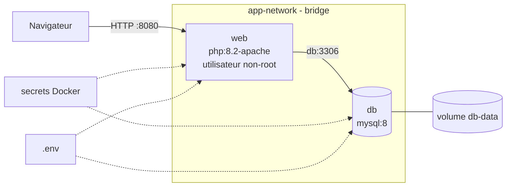

# Architecture

## Analyse de l'application fournie

| Élément | Constat |
|---|---|
| Front + back | Une seule appli PHP (`index.php` affiche et `validation.php` insère), sans API séparée |
| Base de données | Une table `articles`, accédée en PDO (requêtes préparées) |
| Dépendances | PHP 8.2, extensions `pdo_mysql` et `mysqli` |
| Assets | Bootstrap chargé par CDN, aucune compilation : pas de multi-stage nécessaire pour les assets |
| Problèmes initiaux | Hôte `localhost` et identifiants en dur, XSS, erreurs affichées à l'écran |

## Services

| Service | Image de base | Rôle | Port |
|---|---|---|---|
| `web` | `php:8.2-apache` | Sert l'appli PHP | 8080 (hôte) → 8080 (conteneur) |
| `db` | `mysql:8` | Stocke les articles | 3306, interne uniquement |

Adminer ou phpMyAdmin (optionnels) ne sont pas retenus : un service de plus, c'est une surface d'attaque de plus, et il n'est pas utile pour la démonstration.

## Réseau

- `app-network` : réseau bridge personnalisé.
- `web` joint `db` par son nom de service (résolution DNS interne de Docker).
- `db` n'est pas publié sur l'hôte : seule `web` peut l'atteindre.

## Volumes

- `db-data` : volume nommé monté sur `/var/lib/mysql`. Les données survivent à `docker compose down`.

## Configuration et secrets

| Donnée | Où | Commitée ? |
|---|---|---|
| `WEB_PORT`, `DB_HOST`, `DB_PORT`, `MYSQL_DATABASE`, `MYSQL_USER` | `.env` | Non (`.env.example` oui) |
| Mot de passe root et mot de passe applicatif | Secrets Docker (`secrets/*.txt`) | Non (`.example` oui) |

## Schéma

