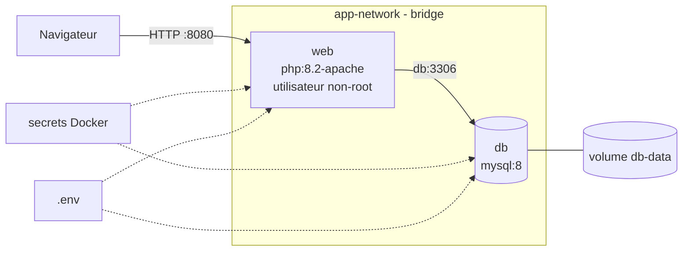

# Architecture

## Analyse de l'application fournie

| Élément | Constat |
|---|---|
| Front + back | Une seule appli PHP (`index.php` affiche et `validation.php` insère), sans API séparée |
| Base de données | Une table `articles`, accédée en PDO (requêtes préparées) |
| Dépendances | PHP 8.2, extensions `pdo_mysql` et `mysqli` |
| Assets | Bootstrap chargé par CDN, aucune compilation : pas de multi-stage nécessaire pour les assets |
| Problèmes initiaux | Hôte `localhost` et identifiants en dur, XSS, erreurs affichées à l'écran |

## Services

| Service | Image de base | Rôle | Port |
|---|---|---|---|
| `web` | `php:8.2-apache` | Sert l'appli PHP | 8080 (hôte) → 8080 (conteneur) |
| `db` | `mysql:8` | Stocke les articles | 3306, interne uniquement |

Adminer ou phpMyAdmin (optionnels) ne sont pas retenus : un service de plus, c'est une surface d'attaque de plus, et il n'est pas utile pour la démonstration.

## Réseau

- `app-network` : réseau bridge personnalisé.
- `web` joint `db` par son nom de service (résolution DNS interne de Docker).
- `db` n'est pas publié sur l'hôte : seule `web` peut l'atteindre.

### Vérifications

| Commande | Résultat obtenu | Ce que ça montre |
|---|---|---|
| `docker network ls` | `articles_app-network` (driver `bridge`) à côté de `bridge`, `host`, `none` | Compose crée un réseau dédié, préfixé par le nom du projet |
| `docker network inspect articles_app-network` | Sous-réseau `172.18.0.0/16`, `db=172.18.0.2`, `web=172.18.0.3` | Seuls les deux conteneurs du projet y sont rattachés |
| `docker exec -it web ping db` | `64 bytes from db.articles_app-network (172.18.0.2)` | Le nom de service `db` est résolu par le DNS interne de Docker (`127.0.0.11`) |
| `docker exec -it web curl http://db:3306` | `curl: (1) Received HTTP/0.9 when not allowed` | Le port 3306 est joignable : MySQL répond avec son handshake binaire, que curl refuse car ce n'est pas du HTTP. C'est le résultat attendu |
| `docker run --rm alpine ping db` | `ping: bad address 'db'` | Un conteneur hors du réseau ne peut ni résoudre ni joindre `db` |

`ping` n'existe pas dans `php:8.2-apache` : le paquet `iputils-ping` est ajouté dans le Dockerfile de `web`.

### Isolation et intérêt du bridge personnalisé

- **Résolution DNS par nom de service** : sur le `bridge` par défaut, les conteneurs ne se joignent que par IP (qui change à chaque recréation). Sur un bridge personnalisé, `DB_HOST=db` suffit et reste stable.
- **Isolation** : seuls les conteneurs explicitement attachés à `app-network` peuvent communiquer avec `db`. Les autres conteneurs de la machine (réseau `bridge` ou autres projets) ne le voient pas.
- **Exposition minimale** : `db` n'a pas de section `ports`, donc 3306 n'est accessible ni depuis l'hôte ni depuis l'extérieur. Seul `web` publie un port (8080).
- **Cloisonnement par projet** : chaque stack Compose a son propre réseau, ce qui évite les collisions de noms et les accès croisés entre projets.

## Volumes

- `db-data` : volume nommé monté sur `/var/lib/mysql`. Les données survivent à `docker compose down`.

## Configuration et secrets

| Donnée | Où | Commitée ? |
|---|---|---|
| `WEB_PORT`, `DB_HOST`, `DB_PORT`, `MYSQL_DATABASE`, `MYSQL_USER` | `.env` | Non (`.env.example` oui) |
| Mot de passe root et mot de passe applicatif | Secrets Docker (`secrets/*.txt`) | Non (`.example` oui) |

## Sécurité

### Scan de vulnérabilités (Trivy)

Commande : `docker run --rm -v /var/run/docker.sock:/var/run/docker.sock aquasec/trivy image --severity HIGH,CRITICAL <image>`

| Image | Avant (HIGH / CRITICAL) | Après (HIGH / CRITICAL) |
|---|---|---|
| `articles-web` (Debian 13) | 117 / 3 | 58 / 1 |
| `articles-db` (Oracle Linux 9) | 33 / 2 | 0 / 0 |

| Vulnérabilité CRITICAL | Correction |
|---|---|
| CVE-2026-93221, CVE-2026-99083 (`linux-libc-dev`, web) | Outils de compilation (`$PHPIZE_DEPS`, `libc6-dev`) purgés après `docker-php-ext-install` : inutiles au runtime |
| GHSA-6q48-6c7w-9gw2 (`certifi`, Python, db) | Suppression de `mysql-shell`, client non utilisé par le serveur |
| CVE-2025-68121 (Go `stdlib` dans `gosu`, db) | Suppression de `gosu` : le conteneur démarre directement en `USER mysql` |
| CVE-2026-6653 (`libxml2`, web) | **Risque accepté** : aucun correctif publié par Debian, bibliothèque requise par PHP et Apache. `apt-get upgrade` au build l'appliquera dès sa sortie |

### Gestion des secrets

- Mots de passe transmis par secrets Docker, montés en fichiers dans `/run/secrets/` (variables `*_PASSWORD_FILE`) : ils n'apparaissent ni dans les Dockerfiles, ni dans les couches d'image, ni dans `docker inspect`.
- L'appli lit le mot de passe via `DB_PASSWORD_FILE` dans `db-config.php` ; hôte, base et utilisateur viennent du `.env`.
- `.env` et `secrets/*.txt` sont exclus par `.gitignore` et `.dockerignore`.

### Limitation des privilèges

| Mesure | `web` | `db` | Effet |
|---|---|---|---|
| `USER` non-root | `www-data` | `mysql` | Une compromission ne donne pas root dans le conteneur |
| Port non privilégié | 8080 | 3306 | Aucune capability nécessaire pour écouter |
| `read_only: true` | Oui (`tmpfs` : `/tmp`, `/var/run/apache2`, `/var/lock/apache2`) | Oui (`tmpfs` : `/tmp`, `/var/run/mysqld`) | Impossible de modifier le code ou de déposer un binaire |
| `cap_drop: [ALL]` | Oui | Oui | Aucune capability Linux (ni `CHOWN`, ni `NET_RAW`, ni `SETUID`...) |
| `no-new-privileges` | Oui | Oui | Bloque l'élévation via binaires setuid |

Vérifié : `docker exec web touch /var/www/html/x` et `docker exec db touch /etc/x` renvoient `Read-only file system`.

### Application

- `display_errors` forcé à `1` dans le code supprimé : les erreurs (chemins, DSN) ne s'affichent plus, elles sont journalisées (`php-hardening.ini`).
- Sorties échappées avec `htmlspecialchars` dans `index.php` (correction d'une XSS stockée).
- Apache et PHP ne divulguent plus leur version (`ServerTokens Prod`, `expose_php = Off`).

## Schéma

